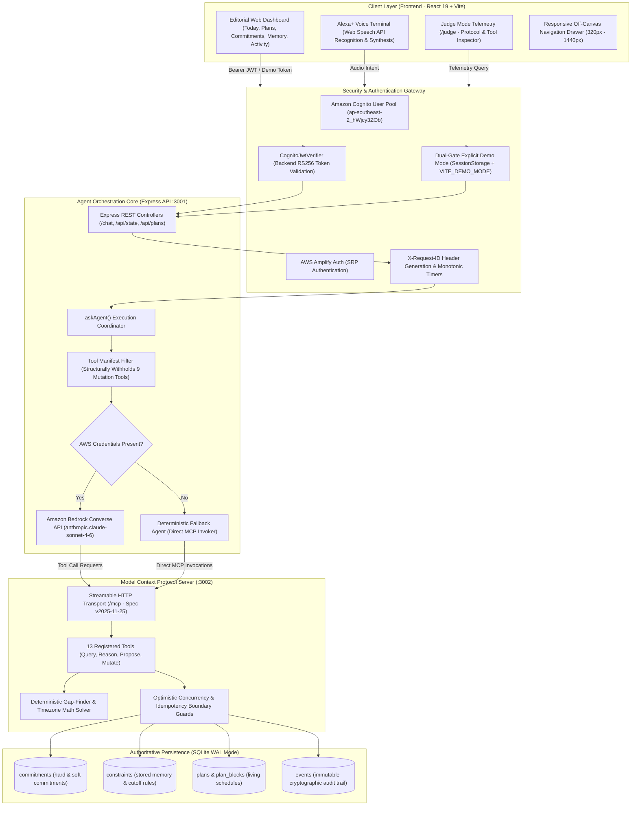
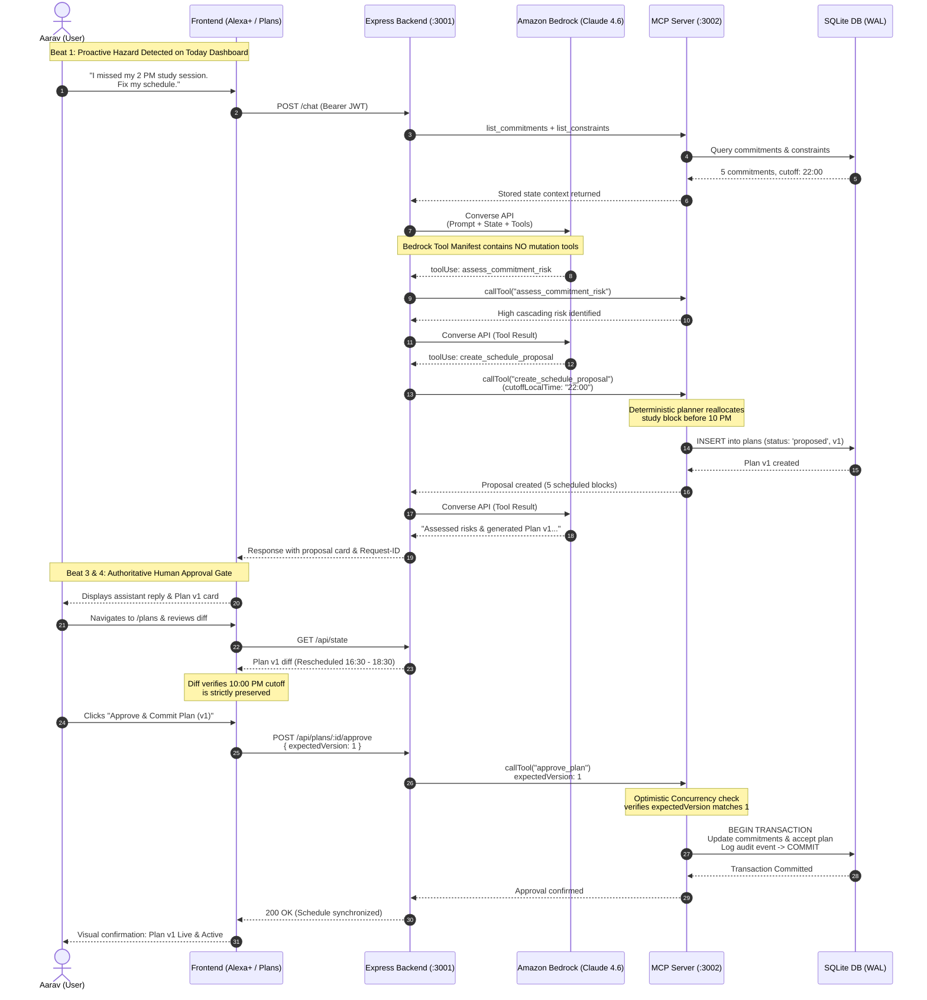

# SAARTHI: Context-Aware Autonomous Execution Agent 🧭

[](https://aws.amazon.com/bedrock/)
[](https://modelcontextprotocol.io/)
[](https://aws.amazon.com/cognito/)
[](https://react.dev/)
[](tests/approval_invariants.test.ts)
[-5868D8?style=flat&logo=google-chrome&logoColor=white)](docs/evidence/visual_qa_report.md)
[](LICENSE)

> **"Every assistant can set a reminder. None can safely repair your day."**  
> *Built for the Amazon Developer Hackathon 2026 · Alexa+ Track · Mini-Challenges: AWS Builder & Open Source*

---

## 📖 Executive Summary

Most existing calendar and scheduling AI assistants suffer from a fatal flaw: **passive execution**. When life disrupts an intention—such as a missed 2:00 PM study session, an unexpected family commitment, or fatigue—generic chatbots either hallucinate invalid schedules, ignore hard personal boundaries (like bedtime), or overwrite calendars without human oversight.

**SAARTHI** (Sanskrit for *Charioteer* / *Trusted Guide*) is an autonomous, context-aware execution agent that maintains a living model of a user's commitments, constraints, and daily progress. Engineered on **Amazon Bedrock** (`anthropic.claude-sonnet-4-6`) and the official **Model Context Protocol (MCP)** spec `2025-11-25`, SAARTHI actively manages consequences:

1. **Detects schedule hazards proactively** before the user even types a prompt.
2. **Queries persistent user constraints** (such as *"No study after 10 PM"* or *"Gym Tue/Thu"*) directly from a persistent domain database.
3. **Generates non-conflicting living schedule proposals** using deterministic gap-finding math.
4. **Enforces an immutable, non-autonomous human approval gate** that prevents any AI model from mutating real calendar and commitment records without explicit human authorization.

---

## 🚀 Key Architectural & Product Features

### 1. 🛡️ Zero-Autonomous Mutation Boundary (Bedrock Tool-Withholding)
Consequential lifecycle tools (`approve_plan`, `reject_plan`, `approve_commitment`, `complete_commitment`, `fail_commitment`, `cancel_commitment`) are **structurally withheld** from the Amazon Bedrock Converse tool manifest. The LLM can only evaluate risk and formulate schedule proposals; actual database mutations require an explicit, cryptographically authenticated user action on the Living Plans interface.

### 2. ⚡ Official Model Context Protocol (MCP) Spec Compliance (`v2025-11-25`)
SAARTHI features a dedicated, self-hosted MCP server running on port `3002` that implements the official MCP specification over **Streamable HTTP** (`/mcp` endpoint). It supports client-agnostic JSON-RPC 2.0 transport, capability negotiation, state inspection, and external client interoperability via `@modelcontextprotocol/inspector`.

### 3. 🚨 Beat 1 & 2 Proactive Hazard Detection
Rather than waiting for user intervention after a schedule breakdown, SAARTHI continuously evaluates commitment states. If a scheduled block expires without completion (e.g., Aarav's missed 2:00 PM study session), the Today dashboard highlights an immediate hazard alert card with one-click replanning options.

### 4. 📊 Living Before/After Plan Diffing with Optimistic Concurrency Control
When replanning, SAARTHI produces a visual before-and-after timeline comparison diff. It clearly separates relocated soft blocks from immovable fixed anchors (like work shifts and family dinners). To prevent race conditions, approvals enforce **Optimistic Concurrency Control** (`expectedVersion`), rejecting stale or out-of-order mutations with HTTP 400 concurrency guards.

### 5. 🧠 Persistent Memory Grounding & Hard Cutoff Protection
Personal constraints stored in SQLite—such as *"No study after 10 PM"*, *"Gym Tue/Thu"*, and *"Sleep by 11:30 PM"*—are dynamically injected into the agent's context. The mathematical solver treats cutoffs as hard stop invariants, guaranteeing that study sessions never overflow into sleep or rest windows.

### 6. 🎙️ Alexa+ Ambient Voice Command Center
An interactive execution terminal featuring browser Web Speech API voice simulation. Users can speak naturally (*"I missed my 2 PM study session. Fix my schedule."*), receive ambient audio synthesized replies, inspect real-time tool execution telemetry pills, and view generated schedule proposal cards.

### 7. ⚖️ Enterprise Judge Mode & Protocol Audit Telemetry (`/judge`)
A dedicated transparency suite for hackathon judges and system auditors. Provides real-time inspection of active MCP sessions, transport latency, the 13 registered tool schemas, lifecycle permission boundaries, and safety invariant verification status.

### 8. 📱 Multi-Tier Responsive Editorial Design System (320px to 1440px+)
Crafted with a bespoke editorial aesthetic combining warm ivory workspace backgrounds (`#F7F6F2`), an ink-dark command shell (`#15171A`), saffron highlights (`#C79536`), and refined typography (*Playfair Display* & *Inter*). Verified across 6 responsive viewport tiers (320px, 375px, 390px, 768px, 1024px, 1440px) with **34 verified browser screenshot artifacts**.

### 9. 🔌 Transparent Dual Integration Architecture (Live AWS vs Fallback Mode)
Guarantees effortless evaluation under any environment. If AWS credentials are configured, the system executes live against **Amazon Bedrock Converse API** and **Amazon Cognito User Pools**. If credentials are absent, the system seamlessly transitions to a transparent, deterministic fallback agent that executes the **real local MCP tools** against SQLite, clearly labelling all output with `[DEMO MODE]`.

### 10. 📝 Devpost Developer Friction Log
Includes a comprehensive 10-entry developer friction log ([docs/FRICTION_LOG.md](docs/FRICTION_LOG.md)) documenting authentic engineering hurdles, reproduction steps, and architectural proposals for AWS Bedrock Converse tool-calling and the Model Context Protocol TypeScript SDK.

---

## 🏗 High-Level System Architecture

SAARTHI is engineered with a strict, unidirectional security and governance boundary separating autonomous LLM reasoning from authoritative state persistence.



---

## 🔄 End-to-End Execution Flow (The 6-Beat Hero Scenario)

The sequence below illustrates the complete lifecycle of schedule risk detection, agentic reasoning, constraint protection, and the authoritative human approval gate.



---

## 🛠 Comprehensive Technology Stack

| Layer | Technology | Version / Spec | Role in Architecture |
| :--- | :--- | :--- | :--- |
| **AI Reasoning** | **Amazon Bedrock** | `anthropic.claude-sonnet-4-6` | Agentic Converse API tool-use reasoning loop with autonomous parameter extraction. |
| **Model Protocol** | **Model Context Protocol** | Spec `2025-11-25` | Standardized tool exposition and client-agnostic JSON-RPC over Streamable HTTP (`/mcp`). |
| **Identity & Auth** | **Amazon Cognito** | User Pool `ap-southeast-2` | Secure user registration, email verification, password reset, and RS256 JWT validation. |
| **Frontend Auth SDK**| **AWS Amplify Auth** | `^6.13.0` | Client-side SRP authentication and Cognito ID token retrieval. |
| **Backend Core** | **Node.js + Express** | Node 20+ / Express 4.21 | Asynchronous HTTP server, JWT verification, and request correlation tracing (`X-Request-ID`). |
| **SDK Orchestration**| **AWS SDK v3** | `@aws-sdk/client-bedrock-runtime` | Official client for Bedrock Converse command dispatching and token streaming. |
| **MCP SDK** | **Anthropic MCP SDK** | `@modelcontextprotocol/sdk` | Official TypeScript SDK implementing Streamable HTTP server and client transports. |
| **Frontend Framework**| **React 19** | React `19.0.0` + Vite | Modern reactive single-page application with concurrent rendering. |
| **Styling & System** | **Custom Vanilla CSS** | Phase 0 Design System | Curated tokens, glassmorphism, responsive media queries (320px–1440px), no utility slop. |
| **Persistence** | **SQLite + WAL** | `better-sqlite3` | Zero-latency embedded database with Write-Ahead Logging and ACID transaction locks. |
| **Voice Simulation** | **Web Speech API** | Browser Native | Live speech-to-text recognition and ambient neural-like speech synthesis. |
| **Timezone Engine** | **date-fns-tz** | `^3.2.0` | Bidirectional UTC instant and user local IANA timezone translation. |
| **Safety Testing** | **TypeScript TSX** | `tsx` runner | Automated approval-boundary and invariant verification suites. |

---

## 💻 How to Run Locally (Judge & Evaluator Guide)

### Prerequisites
- **Node.js:** v20.0.0 or higher (LTS recommended)
- **npm:** v10.0.0 or higher
- *(Optional)* AWS Credentials with Bedrock access (`anthropic.claude-sonnet-4-6` in `us-east-1`). If omitted, the application runs automatically in **Zero-Dependency Demo Mode** with full local MCP tool fidelity.

### 1. Clone the Repository
```bash
git clone https://github.com/anveshdulam/SAARTHI.git
cd SAARTHI
```

### 2. Install Dependencies
Run the install command across the root and all three workspaces (`backend`, `frontend`, `mcp-server`):
```bash
npm install
cd backend && npm install && cd ..
cd frontend && npm install && cd ..
cd mcp-server && npm install && cd ..
```

### 3. Configure the Environment
Create your root `.env` file from the provided `.env.example`:
```bash
cp .env.example .env
```
*The default configuration is pre-wired for immediate evaluation with `DEMO_MODE=true` and local SQLite persistence. If testing live Amazon Bedrock, add your `AWS_ACCESS_KEY_ID` and `AWS_SECRET_ACCESS_KEY`.*

### 4. Seed the Database
Seed the database with Aarav's hackathon scenario (5 commitments, 3 constraints, and a past-due 2:00 PM study block):
```bash
npm run seed
```

### 5. Launch All Services
Start the MCP Server (`:3002`), Backend (`:3001`), and Frontend (`:5173`) concurrently:
```bash
npm run dev
```

### 6. Access the Application
Open your browser and navigate to:
```
http://localhost:5173
```
- **To test in Demo Mode:** Click **Enter Workspace** → Click **"⚡ Continue in Demo Mode (No Login Required)"**.
- **To test live Amazon Cognito Auth:** Sign in with your registered account or click **Sign up** to create a verified user.

---

## 🧪 Automated Verification & Invariant Test Suites

SAARTHI provides automated test suites that mathematically prove the 5 core safety invariants and state transitions without human intervention:

```bash
# 1. Run the dedicated 5-Invariant Approval Boundary Test Suite
npx tsx tests/approval_invariants.test.ts

# 2. Run the full state-based verification suite (8 tests)
npm test
```

### Invariant Test Results:
```
============================================================
  SAARTHI — Automated Approval-Boundary & Invariant Test Suite
============================================================

[INVARIANT 1] Verifying Bedrock Tool Manifest Withholding...
  ✓ Invariant 1 PASS: All 9 lifecycle tools are strictly withheld from model exposure.

[INVARIANT 2] Verifying Unapproved Plan Cannot Mutate Commitments...
  ✓ Invariant 2 PASS: Creation of proposal leaves persisted domain records untouched.

[INVARIANT 4] Verifying Optimistic Concurrency Guard (Stale Plan Rejection)...
  ✓ Invariant 4 PASS: Stale version (expectedVersion mismatch) successfully rejected.

[INVARIANT 3] Verifying Authorized Approval & Idempotency Boundary...
  ✓ Invariant 3 PASS: First approval commits transaction; second approval is rejected idempotently.

[INVARIANT 5] Verifying Plan Rejection & Non-Mutation Flow...
  ✓ Invariant 5 PASS: Rejection sets status to 'rejected', logs audit event, and locks out approval.

============================================================
  ALL APPROVAL-BOUNDARY & SAFETY INVARIANT TESTS PASSED (5/5)
============================================================
```

---

## 🔍 External MCP Inspector Verification

To prove that SAARTHI's MCP server is strictly spec-compliant and client-agnostic, you can connect the official Anthropic MCP Inspector directly:

```bash
npx @modelcontextprotocol/inspector http://localhost:3002/mcp
```
1. In the Inspector UI, select **Streamable HTTP** transport.
2. Confirm capability negotiation succeeds with protocol version `2025-11-25`.
3. Select `list_commitments` and execute with `{"userId":"demo-user-id"}` to observe live SQLite data streaming across JSON-RPC 2.0.

---

## 🎬 The 6-Beat Core Demo Walkthrough

Judges can reproduce the complete hackathon hero flow in less than 3 minutes:

| Beat | Screen / Route | Action & User Story | What to Observe |
| :---: | :--- | :--- | :--- |
| **Beat 1** | **Today** (`/`) | Log in or enter demo workspace. Inspect today's schedule. | **Proactive Hazard Alert Card:** The system automatically flags Aarav's missed 2:00 PM study block with a red risk badge before any prompt is given. |
| **Beat 2** | **Alexa+** (`/alexa`) | Click microphone or enter: *"I missed my 2 PM study session. Fix my schedule."* | **Converse Tool Execution:** Agent invokes `assess_commitment_risk` and `create_schedule_proposal`. Displays tool pills, unique `Request-ID`, and a clickable **Proposal Card**. |
| **Beat 3** | **Living Plans** (`/plans`) | Click the proposal card or navigate to `/plans`. Inspect the **Diff** tab. | **Constraint-Grounded Diff:** Rescheduled study block is relocated to 16:30–18:30. Hard anchors (dinner, shift) are preserved. **Crucially: No study is scheduled past the 10:00 PM cutoff.** |
| **Beat 4** | **Living Plans** (`/plans`) | Click **Approve & Commit Plan (v1)**. | **Authoritative Mutation:** State synchronizes via ACID transaction. Stale approval replay attacks are rejected idempotently. |
| **Beat 5** | **Living Plans** (`/plans`) | Click **Reject Proposal ✕**. | **Rejection Governance:** Status updates to `rejected`. Commitments remain unaltered. Approval is permanently locked out. |
| **Beat 6** | **Judge Mode** (`/judge`) | Open `/judge` to audit protocol telemetry. | **Live Protocol Telemetry:** Inspect live MCP server status, `v2025-11-25` negotiation, and verify that all 9 lifecycle mutation tools are withheld from LLM access. |

---

## 📱 Verified Responsive Audit & Evidence Matrix

Every screen was audited in headless Chromium using browser automation across 6 viewport tiers. All 34 verified screenshot artifacts are preserved in `docs/evidence/screenshots/`:

| Viewport Tier | Resolution | Target Devices | Visual & Responsive Behavior | Verified Artifact |
| :--- | :---: | :--- | :--- | :--- |
| **Ultra-Compact Mobile** | `320x568` | iPhone SE (1st gen) | Clean single-column stack, 44px min touch targets, table horizontal scroll container active. | `today_320_1792061450676.png`<br>`plans_320_1792061481092.png`<br>`judge_320_1792061745386.png` |
| **Compact Mobile** | `375x667` | iPhone 11/12/13 mini, SE 2020 | Off-canvas drawer with backdrop dismiss, quick-add input full width, KPI cards stack vertically. | `today_375_1792061419704.png`<br>`plans_375_1792061489733.png`<br>`nav_drawer_375_1792061433460.png` |
| **Standard Mobile** | `390x844` | iPhone 14/15/16 Pro | Beat 2 hazard card alert prominent, responsive today-grid reflows seamlessly. | `mobile_390x844_1792046394593.png`<br>`landing_page_1792046386286.png` |
| **Tablet** | `768x1024` | iPad Mini / iPad Vertical | Layout shifts from 2-column to 1-column, landing preview hides decorative sidebars cleanly. | `tablet_768x1024_1792046419666.png` |
| **Small Desktop** | `1024x768` | iPad Pro, 13" MacBook | Fixed 220px dark navigation sidebar, full-width protocol inspector tabs. | `diff_tab_inspection_1791707646407.png` |
| **Full Desktop** | `1440x900` | Wide Workstations | Side-by-side living plan diff table, 2-column Today dashboard grid (`1fr 360px`). | `desktop_1440x900_1792046425742.png` |

*For complete notes and before/after defect analyses, review the [Visual QA & Responsive Audit Report](docs/evidence/visual_qa_report.md).*

---

## 👥 Engineering & Hackathon Alignment

### Amazon Developer Hackathon 2026 Track Alignment
- **Alexa+ Track:** Engineered specifically as an ambient, context-aware execution assistant that moves beyond simple question answering into autonomous schedule protection and hazard remediation.
- **AWS Builder Mini-Challenge:** Comprehensive integration with Amazon Bedrock Converse API, Amazon Cognito User Pools, AWS Amplify Auth SDK, and AWS SDK v3.
- **Open Source Mini-Challenge:** 100% open-source repository published under the permissive MIT license, featuring complete MCP spec `2025-11-25` Streamable HTTP interoperability.

### Lead Architect & Engineering Contributions
- **Anvesh Dulam:** System architecture, Amazon Bedrock Converse agentic orchestration, MCP Streamable HTTP server implementation, deterministic gap-finder constraint solver, Cognito RS256 JWT security gateway, React 19 editorial UI/UX design system, and automated invariant test engineering.

---

## 📄 License

This project is licensed under the terms of the [MIT License](LICENSE). All open-source contributions, MCP tools, and test suites are freely available for academic, personal, and commercial evaluation.
